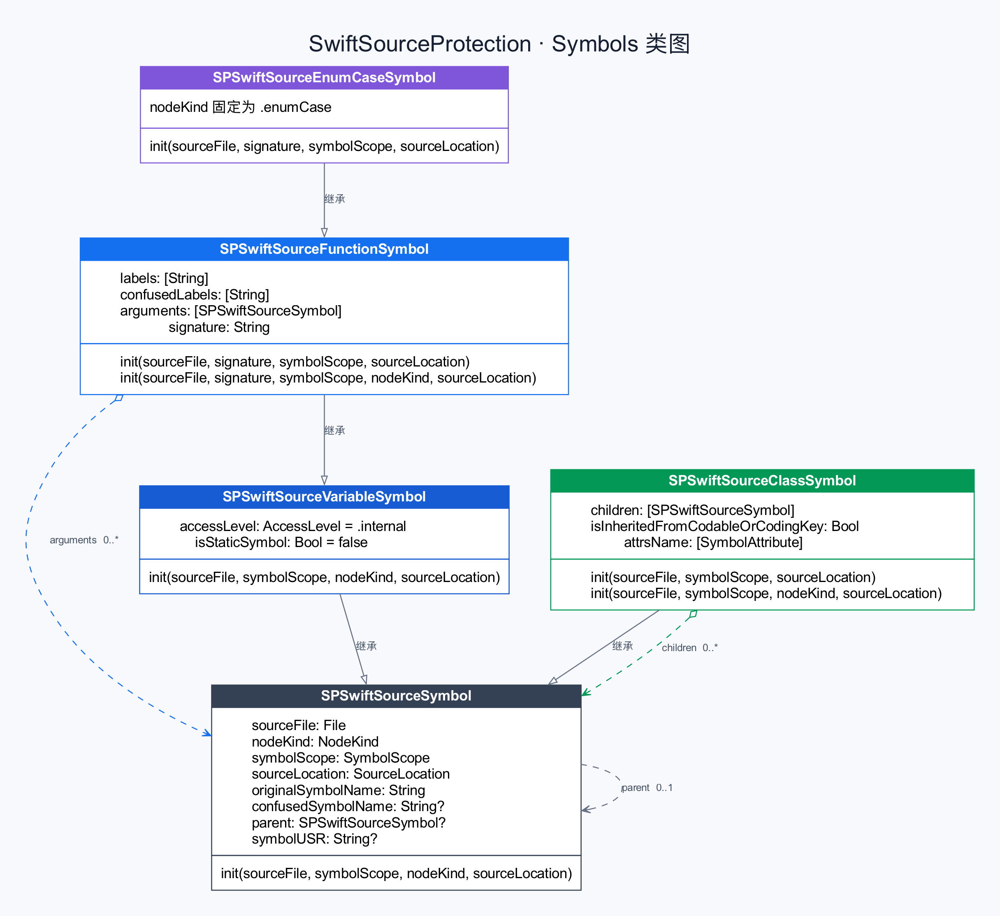
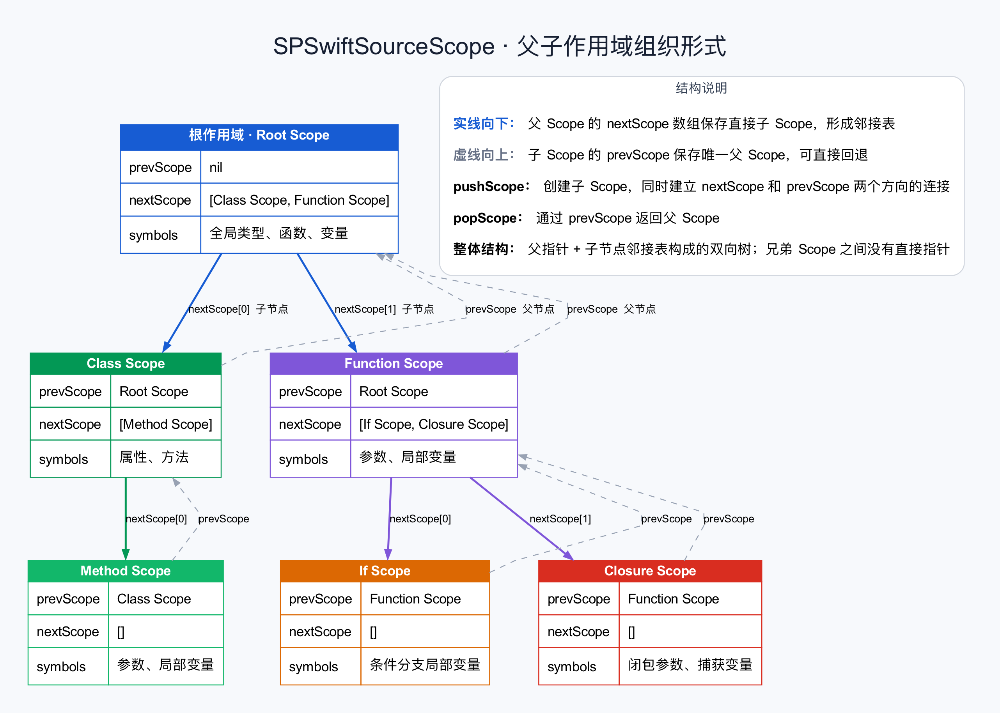

# SwiftSourceProtection 实现原理

本文档说明 `SwiftSourceProtection` 当前代码的核心实现思路。项目的目标是在尽量保持 Swift 语义和 Xcode 工程可编译的前提下，对源码符号做混淆，并可选对源码声明顺序做乱序处理。

## 1. 项目是做什么的

### 1.1 项目目标

`SwiftSourceProtection` 是一个面向 Swift 项目的源码保护工具。它通过修改源码中的类型名、方法名、变量名和参数标签，降低代码在交付后被直接阅读和理解的可能性。

与简单的文本替换不同，本项目会先分析 Swift 源码的语法结构和符号引用关系，再对同一个符号的声明位置和使用位置进行统一修改。这样可以尽量保证混淆后的源码仍然符合 Swift 语法，并能够继续参与 Xcode 工程的编译。

除了符号名称混淆，项目还提供字符串加密、声明顺序打乱、源码文件重命名以及根据映射表恢复名称等功能。

### 1.2 当前支持的功能

当前项目支持以下功能：

1. **Swift 符号混淆**：对源码中的类型、函数、变量、参数标签和枚举成员等符号进行重命名，并同步修改对应的引用位置。
2. **Swift 源码反混淆**：读取混淆时生成的 `confused.json` 映射表，将已混淆的符号名称恢复为原始名称。
3. **源码声明乱序**：随机调整文件顶层声明以及类型成员的排列顺序，但不会打乱函数体内部语句。
4. **字符串字面量保护**：将字符串内容转换为加密后的字节数据，并在项目中生成运行时解密所需的辅助代码。
5. **项目文件混淆**：重命名 Swift 源文件，并同步更新 Xcode Project、Workspace 和 Scheme 中的相关引用。
6. **预览处理结果**：通过 `dry-run` 模式将处理后的源码输出到终端，而不写回原文件。

这些功能可以通过命令行参数分别启用。其中符号混淆是主要功能，源码乱序和文件重命名属于可选功能。

## 2. 项目的整体处理流程

### 2.1 读取命令行参数

程序从 `main.swift` 启动，并由 `SPArgumentParser` 解析命令行参数。用户需要指定待处理的 Xcode 工程路径和 Scheme，同时选择执行混淆还是反混淆。

解析完成后，程序会将参数整理为 `SPObfuseArgument` 或 `SPDeObfuseArgument`，再创建 `SPSourceProtection` 并调用 `run()` 开始处理。后续各个阶段都会根据这些参数决定是否读取映射表、是否执行源码乱序、是否重命名文件以及是否将结果写回磁盘。

### 2.2 获取工程中的 Swift 文件

程序通过 `SPSchemeInfoProvider` 读取指定的 Project 或 Workspace，并获取 Scheme 对应的构建信息。构建信息中包含参与编译的 Module、Swift 源文件路径以及 SourceKit 分析源码时需要使用的编译参数。

获取结果会被整理为一组 `Module`。每个 `Module` 保存模块名称、该模块包含的 Swift 文件以及对应的编译参数。后续源码分析会以 Module 为单位依次执行。

### 2.3 解析和分析源码

对于每个 Swift 文件，程序首先读取源码内容，并使用 SwiftSyntax 将文本解析为 `SourceFileSyntax` 语法树。随后，`SPSwiftSourceASTCollector` 遍历语法树，收集其中的类型、函数、变量、参数和枚举成员等符号，同时记录这些符号所在的作用域。

仅依靠语法树无法准确判断一个名称引用的是哪个声明，因此程序还会使用 SourceKit 对源码进行索引。SourceKit 提供符号的 USR、声明位置和引用位置等信息，程序据此将跨作用域、跨文件的声明和引用关联到同一个符号对象。

完成索引后，`SPSwiftSourceASTPreRewriter` 会再次遍历源码，将语法树中的标识符节点与已经收集到的符号建立对应关系，为正式重写做好准备。

### 2.4 重写并输出源码

分析完成后，程序使用 `SPSwiftSourceASTRewriter` 重写语法树。在混淆模式下，重写器会把符号的声明名称和引用名称替换为生成的混淆名称，并处理函数参数标签、初始化器、枚举成员、成员访问和字符串字面量等需要单独处理的语法。

如果启用了 `shuffle`，程序会在重写后继续使用 `SPSwiftSourceASTShuffler` 打乱文件声明和类型成员的顺序。如果没有启用 `dry-run`，最终源码会写回原 Swift 文件；启用 `dry-run` 时，结果只会打印到终端。

源码处理完成后，程序可以根据参数继续重命名项目中的 Swift 文件。执行混淆命令时，还会在工程目录生成 `confused.json`，用于记录原始名称和混淆名称之间的对应关系；执行反混淆命令时，则会读取已有的映射表并恢复符号名称。

## 3. 命令行参数

程序使用 `ArgumentParser` 解析命令行参数，并提供两个子命令：

- `obfuse`：混淆指定的 Swift 工程。
- `deobfuse`：根据映射表反混淆指定的 Swift 工程。

两个子命令都需要传入工程文件路径和 Scheme 名称。工程路径可以指向 `.xcodeproj` 或 `.xcworkspace`。

### 3.1 obfuse 混淆命令

`obfuse` 用于对指定工程执行源码混淆，其基本格式如下：

```shell
SwiftSourceProtection obfuse <project> <scheme> [--dry-run] [--shuffle] [--rename]
```

其中：

- `project`：需要处理的 `.xcodeproj` 或 `.xcworkspace` 路径。
- `scheme`：需要处理的 Scheme 名称。
- `--dry-run`、`--shuffle` 和 `--rename`：可选功能，具体作用见 3.3 节。

例如：

```shell
SwiftSourceProtection obfuse ./Example.xcodeproj Example --shuffle
```

执行命令后，程序会分析工程中参与该 Scheme 编译的 Swift 文件，对符合条件的符号和字符串进行重写。如果启用了 `--shuffle`，还会在重写后执行声明乱序。处理完成后，程序会生成 `confused.json`，用于记录混淆名称与原始名称之间的对应关系。

### 3.2 deobfuse 反混淆命令

`deobfuse` 用于根据 `confused.json` 恢复已经混淆的符号名称，其基本格式如下：

```shell
SwiftSourceProtection deobfuse <project> <scheme> <map> [--dry-run] [--rename]
```

其中：

- `project`：已经被混淆的 `.xcodeproj` 或 `.xcworkspace` 路径。
- `scheme`：当前工程使用的 Scheme 名称。
- `map`：混淆阶段生成的 `confused.json` 文件路径。
- `--dry-run` 和 `--rename`：可选功能，具体作用见 3.3 节。

例如：

```shell
SwiftSourceProtection deobfuse ./Example.xcodeproj Example ./confused.json
```

执行命令后，程序会加载映射表，重新分析工程中的声明和引用，并将映射表中存在的混淆名称替换为原始名称。`deobfuse` 主要用于恢复符号名称，不会自动恢复由 `--shuffle` 造成的声明顺序变化。

### 3.3 dry-run、shuffle 和 rename 选项

- `--dry-run`：预览处理结果，不将重写后的源码写回原文件，而是输出到终端。
- `--shuffle`：执行源码声明乱序。程序会分别打乱文件中的 `import` 声明、其他顶层声明，以及 `class`、`struct`、`enum`、`protocol` 和 `extension` 中的成员顺序。`import` 仍会整体位于其他顶层声明之前。当前没有保存原始顺序，因此**乱序后无法通过反混淆命令恢复**。该选项只用于 `obfuse` 命令。
- `--rename`：设计上用于随机重命名工程相关内容，包括部分目录、Swift 源文件、工程名、Scheme、Target 和 Podfile 中的相关名称。重命名后，执行反混淆时需要使用重命名后的工程路径和 Scheme。

## 4. 获取 Xcode 工程信息

SwiftSyntax 只负责解析源码的语法结构，而 SourceKit 还需要模块名称、SDK 路径、条件编译参数等真实的编译信息。为此，程序通过 `SPSchemeInfoProvider` 执行一次 Xcode 构建，并从构建日志中提取后续分析所需的 Module、Swift 文件和编译参数。

### 4.1 检查 Xcode

程序首先执行以下命令，检查当前系统是否已经正确配置 Xcode 开发者目录：

```shell
xcode-select -p
```

如果命令执行成功，程序继续获取工程信息；如果命令执行失败，则输出 `Cannot find Xcode.` 并中止本次处理。

### 4.2 读取 Project、Workspace 和 Scheme

`SPSchemeInfoProvider` 根据工程路径的扩展名判断工程类型：路径以 `.xcworkspace` 结尾时使用 `-workspace`，其他情况使用 `-project`。随后，程序使用用户传入的 Scheme，在 iPhone 模拟器 SDK 环境下执行以下构建命令：

```shell
xcodebuild -scheme <scheme> -project <project> -sdk iphonesimulator clean build
```

如果传入的是 Workspace，则命令中的 `-project` 会替换为 `-workspace`。其中 `clean` 用于先清理已有的构建结果，`build` 用于触发完整构建并输出真实的 Swift 编译命令。

程序会等待构建结束。构建成功后继续解析输出内容；如果构建失败，则打印构建日志并中止后续处理。

### 4.3 获取 Swift 编译参数

程序使用 `Pipe` 同时接收 `xcodebuild` 的标准输出和错误输出，然后逐行查找包含 `/usr/bin/swiftc` 和 `-module-name` 的 Swift 编译命令。每条编译命令对应一个待分析的 Module，其中包含 SourceKit 建立索引时需要的真实编译参数。

如果编译命令通过 `@...SwiftFileList` 引用了文件列表，程序会读取该文件，并将其中的 Swift 文件路径补充到编译参数中。随后，程序会移除部分只用于构建输出或增量编译、但不适合 SourceKit 索引的参数，例如 `-output-file-map`、`-parseable-output` 和 `-incremental`。

为了便于源码分析，程序还会将 `-O` 调整为 `-Onone`，并补充 `DEBUG` 条件编译标记。处理后的参数最终保存在对应 `Module` 的 `compilerArguments` 中。

### 4.4 获取 Module 和 Swift 文件

程序从 Swift 编译命令的 `-module-name` 参数中取得模块名称，并从 `-c` 后面的参数或 `SwiftFileList` 中取得参与该模块编译的 Swift 文件。解析结果会被整理为 `Module`：

```swift
struct Module: Hashable {
    let name: String
    let sourceFiles: Set<File>
    let compilerArguments: [String]
}
```

同一模块只保留首次解析到的完整编译参数。所有 Module 会按照它们在构建日志中首次出现的顺序返回，以供后续源码收集和索引流程使用。

如果某个 Module 的源码文件路径中包含 `Pods`，程序会将整个 Module 过滤掉，避免对 CocoaPods 引入的第三方源码进行混淆。最终保留下来的 Module 才会参与后续处理。

## 5. 收集源码中的符号

### 5.1 符号种类和范围

程序使用 `NodeKind` 区分符号种类。目前内部符号分为类型、变量、函数和枚举 Case 四类：

```swift
enum NodeKind {
    case `class`
    case variable
    case function
    case enumCase
}
```

其中，`class` 不只表示 Swift 的 `class`，也统一用于表示 `struct`、`protocol`、`enum` 和 `extension` 等能够包含成员的类型声明。

程序同时使用 `SymbolScope` 描述符号在源码中的范围：

```swift
enum SymbolScope {
    case member
    case global
    case local
}
```

- `global`：定义在文件顶层的符号。
- `member`：定义在类型内部的成员符号。
- `local`：定义在函数、闭包或控制流语句内部的局部符号。

符号种类和符号范围会共同参与后续的混淆判断。例如，局部变量通常可以直接生成混淆名称，而类型成员还需要结合访问级别、继承关系和 SourceKit 索引结果进一步判断。

#### 5.1.1 基本符号

`SPSwiftSourceSymbol` 是所有符号模型的基类，保存各类符号都需要使用的公共信息：

```swift
class SPSwiftSourceSymbol {
    var sourceFile: File

    var nodeKind: NodeKind

    var symbolScope: SymbolScope

    var sourceLocation: SourceLocation

    var originalSymbolName: String

    var confusedSymbolName: String?

    var parent: SPSwiftSourceSymbol?

    var symbolUSR: String?
}
```

- `sourceFile`：符号所在的 Swift 源文件。
- `nodeKind`：符号的具体种类。
- `symbolScope`：符号属于全局、成员还是局部范围。
- `sourceLocation`：符号名称在源码中的行号和列号。
- `originalSymbolName`：符号在当前源码中的原始名称。
- `confusedSymbolName`：准备写入源码的目标名称；尚未决定或不允许混淆时为 `nil`。
- `parent`：当前符号所属的父类型符号。
- `symbolUSR`：SourceKit 提供的统一符号标识，用于关联声明和引用。并非所有局部符号都能获得 USR。

符号初始化时会根据源码位置将自身登记到 `IndexStore`。后续设置 `symbolUSR` 时，也会同步建立 USR 到符号对象的索引。

#### 5.1.2 类符号

`SPSwiftSourceClassSymbol` 用于表示能够包含成员的声明，包括 `class`、`struct`、`protocol`、`enum` 和 `extension`：

```swift
class SPSwiftSourceClassSymbol: SPSwiftSourceSymbol {
    lazy var children: [SPSwiftSourceSymbol]
    var isInheritedFromCodableOrCodingKey: Bool
    lazy var attrsName: [SymbolAttribute]
}
```

- `children`：保存类型内部收集到的属性、方法、嵌套类型和枚举 Case 等成员符号。
- `isInheritedFromCodableOrCodingKey`：记录该类型是否直接声明遵守 `Codable` 或 `CodingKey`，供后续保护相关成员名称。
- `attrsName`：记录类型上的特殊属性，当前主要识别 `@resultBuilder`。

#### 5.1.3 变量符号

`SPSwiftSourceVariableSymbol` 用于表示成员属性、全局变量、局部变量、函数参数和闭包参数：

```swift
class SPSwiftSourceVariableSymbol: SPSwiftSourceSymbol {
    var accessLevel: AccessLevel
    var isStaticSymbol: Bool
}
```

- `accessLevel`：符号的访问级别，默认值为 `internal`。收集器会从声明修饰符中识别以下级别：

```swift
enum AccessLevel {
    case `open`
    case `public`
    case `package`
    case `internal`
    case `fileprivate`
    case `private`
}
```

- `isStaticSymbol`：记录声明是否带有 `static` 修饰符，后续会作为混淆判断条件之一。

#### 5.1.4 方法符号

`SPSwiftSourceFunctionSymbol` 用于表示函数和初始化器。它继承自 `SPSwiftSourceVariableSymbol`，因此同样具有访问级别和静态属性：

```swift
class SPSwiftSourceFunctionSymbol: SPSwiftSourceVariableSymbol {
    var labels: [String] = []
    var confusedLabels: [String] = []

    var arguments: [SPSwiftSourceSymbol] = []
    var signature: String
}
```

- `labels`：函数声明中的原始参数标签。
- `confusedLabels`：参数标签重写后对应的名称。
- `arguments`：函数参数所对应的变量符号。
- `signature`：由函数名和参数标签组成的签名，例如 `loadUser(id:)`，用于区分同名重载函数。

函数符号存入作用域时以 `signature` 作为 Key，其他符号则以 `originalSymbolName` 作为 Key。

#### 5.1.5 枚举 Case 符号

`SPSwiftSourceEnumCaseSymbol` 继承自 `SPSwiftSourceFunctionSymbol`。这是因为带关联值的枚举 Case 与函数类似，除了 Case 名称以外，还需要记录关联值标签和完整签名。

该类在初始化时会将 `nodeKind` 固定为 `enumCase`，使后续逻辑能够将它与普通函数区分开来。

#### 5.1.6 整体类图



### 5.2 作用域定义

`SPSwiftSourceScope` 用于保存某一段源码范围内可见的符号，并通过父子关系还原 Swift 源码中的嵌套结构：

```swift
class SPSwiftSourceScope {
    private var symbols: [String: SPSwiftSourceSymbol]
    private var nextScope: [SPSwiftSourceScope]
    private var prevScope: SPSwiftSourceScope?

    func pushScope() -> SPSwiftSourceScope

    func popScope() -> SPSwiftSourceScope

    func pushSymbol(_ symbol: SPSwiftSourceSymbol)

    func findSymbolWithUSR(_ usr: String) -> SPSwiftSourceSymbol?

    func findSymbolWithSymbolName(_ symbolName: String, inCurrentScope: Bool = false) -> SPSwiftSourceSymbol?
}
```

- `symbols`：当前作用域直接包含的符号字典。
- `nextScope`：当前作用域的所有直接子作用域，形成子节点邻接表。
- `prevScope`：当前作用域的唯一父作用域。
- `pushScope()`：创建子作用域，同时建立父子两个方向的连接，并返回新作用域。
- `popScope()`：通过 `prevScope` 返回父作用域；根作用域没有父节点时返回自身。
- `pushSymbol(_:)`：将非空名称的符号加入当前作用域。函数以签名为 Key，其他符号以名称为 Key。
- `findSymbolWithUSR(_:)`：从当前作用域开始，逐层向父作用域查找指定 USR 的符号。
- `findSymbolWithSymbolName(_:inCurrentScope:)`：按名称或函数签名查找符号。默认会逐层向父作用域查找；`inCurrentScope` 为 `true` 时只检查当前层。

作用域采用“父指针 + 子节点邻接表”的双向树结构。兄弟作用域之间没有直接连接：



### 5.3 使用 SwiftSyntax 解析源码

每个 Swift 文件都会先通过 `Parser.parse(source:)` 解析为 `SourceFileSyntax`。随后，程序创建 `SPSwiftSourceASTCollector`，并调用 `walk()` 遍历整棵语法树。

`SPSwiftSourceASTCollector` 继承自 SwiftSyntax 的 `SyntaxVisitor`，使用 `.sourceAccurate` 模式访问源码节点。收集器内部维护以下状态：

- `topScope`：当前文件的根作用域。
- `currentScope`：遍历过程中正在使用的作用域。
- `parentStack`：当前嵌套的类型符号栈，用于建立成员符号的 `parent` 和 `children` 关系。
- `locationConverter`：将 SwiftSyntax 节点位置转换为文件中的行号和列号。
- `extensions`：暂存 extension 中收集到的类型信息和成员。

进入类型、函数、闭包或控制流节点时，收集器调用 `pushScope()` 创建子作用域；离开节点时，在对应的 `visitPost` 方法中调用 `popScope()` 回到父作用域。同时，程序会将语法节点 ID 和当前 Scope 保存到 `IndexStore`，供预处理和源码重写阶段查找。

遍历完成后，`walk()` 将文件根节点与 `topScope` 建立映射，并返回该文件的完整作用域树。

### 5.4 收集类型、函数和变量

收集器为不同的 SwiftSyntax 节点实现了对应的 `visit` 方法：

- `ClassDeclSyntax`、`StructDeclSyntax`、`ProtocolDeclSyntax` 和 `EnumDeclSyntax`：创建类型符号，记录名称、源码位置、继承信息和特殊属性，然后进入该类型的成员作用域。
- `ExtensionDeclSyntax`：创建临时类型符号并收集扩展成员，文件遍历结束后再合并到对应的原类型符号。
- `VariableDeclSyntax`：从绑定模式中提取一个或多个变量名，并识别 `static` 和访问级别修饰符。
- `FunctionDeclSyntax` 和 `InitializerDeclSyntax`：创建函数符号，生成包含参数标签的签名，并建立函数体作用域。
- `FunctionParameterSyntax`：创建参数变量符号，同时将参数符号和标签登记到所属函数中。
- `EnumCaseDeclSyntax`：为每个 Case 创建枚举 Case 符号，并记录关联值标签和签名。
- `ClosureParameterSyntax`、`ClosureShorthandParameterSyntax` 和 `ClosureCaptureSyntax`：收集闭包参数、简写参数和捕获列表中的局部名称。

对于元组绑定、可选绑定和模式匹配，程序通过 `extractPatternNames` 递归提取其中的标识符，因此可以处理 `let (a, b)`、`if let value` 和 `case let` 等不是单一标识符声明的情况。

### 5.5 收集控制流中的局部作用域

除了声明节点，收集器还会为 `for`、`while`、`if`、`switch`、`guard`、`do`、`repeat`、`catch`、访问器和闭包等语法创建对应的局部作用域。

这些节点中通过可选绑定、模式匹配、循环变量或 `catch` 模式产生的局部符号，会被放入正确的 Scope。这样在后续查找某个标识符时，程序可以先检查当前作用域，再沿 `prevScope` 向上查找，同时避免错误地访问同级或已经离开的作用域。

### 5.6 建立符号父子关系与合并 Extension

作用域树用于描述符号的可见范围，`parentStack` 则用于描述类型成员关系。收集到成员属性、成员方法、嵌套类型或枚举 Case 时，程序会把当前类型设置为该符号的 `parent`，并将符号加入类型的 `children`。

extension 在遍历时会先保存到 `extensions` 数组。文件遍历结束后，收集器按扩展类型名称在根作用域中查找原类型：如果找到，就把扩展成员的 `parent` 改为原类型，并追加到原类型的 `children`；同时合并 `Codable` 或 `CodingKey` 标记。如果没有找到原类型，则将该 extension 对应的类型符号保留在文件根作用域中。

## 6. 使用 SourceKit 关联符号

### 6.1 获取声明和引用信息

SwiftSyntax 可以准确解析源码的语法结构，但无法完整判断某个标识符最终指向哪个声明。为获得语义信息，`SPSwiftSourceASTCollector.index` 会使用当前 Module 的真实编译参数，向 SourceKit 发送 `source.request.indexsource` 请求。

SourceKit 返回的索引结果中包含声明、引用、符号名称、USR、源码位置和关联关系等信息。程序递归遍历这些结果，并将它们保存到全局的 `IndexStore` 中，主要建立以下映射：

- 文件到完整 SourceKit 索引响应。
- USR 到 SourceKit 响应。
- USR 到声明所在文件。
- 文件及源码位置到声明或引用响应。
- USR 到项目内部的 `SPSwiftSourceSymbol`。

其中，USR 是 SourceKit 为符号生成的统一标识。即使同名符号出现在不同类型、文件或作用域中，它们通常也拥有不同的 USR，因此比单纯使用名称匹配更可靠。

### 6.2 关联同一符号的声明和使用位置

完成索引后，`associate` 会再次遍历 SourceKit 响应，并根据行号、列号、名称和 `NodeKind`，将 SourceKit 中的声明与第 5 节收集到的符号对象匹配起来。

不同声明的匹配方式略有区别：类型和变量使用符号名称匹配，函数和枚举 Case 使用包含参数标签的完整签名匹配。匹配成功后，程序把 SourceKit 提供的 USR 写入符号对象，并根据符号类型、外部继承关系和特殊保护规则决定是否生成混淆名称。

随后，`SPSwiftSourceASTPreRewriter` 会遍历源码中的 identifier Token。它优先根据 Token 的源码位置找到 SourceKit 引用，再通过引用的 USR 找到目标符号；如果 SourceKit 没有提供可用引用，则回退到当前 Scope 中按名称查找局部符号。

关联结果最终保存到 `SymbolIndexRelator`，形成“SwiftSyntax Token ID → 符号对象”的映射。正式重写阶段只替换已经关联到确定符号的 Token，避免把相同文本但含义不同的名称一起替换。

### 6.3 处理跨文件符号

`IndexStore` 在整个处理流程中由所有文件共享，因此一个文件中的引用可以通过 USR 找到另一个文件中的声明符号。主流程会先完成同一 Module 内所有文件的收集和索引，再执行关联，以保证跨文件声明已经进入索引。

对于属性和方法，程序还会检查 SourceKit 返回的 `related` 关系。如果关联链指向当前 Module 之外的文件，则认为该符号受到外部类型或协议约束，不生成混淆名称。该处理主要用于保护系统框架方法、外部协议实现和 override 成员，避免只修改当前项目源码后破坏外部调用约定。

跨 Module 关联依赖 SourceKit 返回的 USR 和 related 信息，其准确性也会受到构建参数、条件编译和 SourceKit 索引结果的影响。

## 7. 生成混淆名称

### 7.1 混淆名称的生成规则

混淆名称由 `ConfuseHelper.confusedSymbolName` 统一生成。首次处理某个名称时，程序会随机生成一个长度为 1～31 个字符的新标识符：首字符从大小写字母和下划线中选择，后续字符从大小写字母和数字中选择。

程序使用 `confusedTable` 保存“原始名称 → 混淆名称”，使用 `reversedTable` 保存“混淆名称 → 原始名称”。如果同一个原始名称再次出现，会复用已经生成的混淆名称；如果随机结果与已有名称重复或属于 Swift 保留名称，则重新生成。

反混淆模式下不会生成随机名称，而是直接使用传入的 `confused.json` 查询目标名称。映射表中不存在的名称保持不变。

### 7.2 不需要混淆的符号

并非所有标识符都适合修改。当前实现会跳过以下几类名称：

- Swift 关键字、上下文关键字、基础类型和项目维护的常见保留名称。
- SourceKit 判断为继承或实现外部 API 的属性和方法。
- `Codable` 或 `CodingKey` 类型中依赖名称完成编码的属性和枚举 Case。
- Result Builder 中由编译器按固定名称识别的构建方法。
- 没有满足 `shouldConfuseSymbol` 条件，且没有在 SourceKit 关联阶段确认可以混淆的成员符号。

此外，预关联阶段会跳过元组标签、函数调用参数标签和部分成员访问名称。这些位置不能按普通 identifier Token 直接替换，需要由正式重写器结合函数或成员信息单独处理。

### 7.3 函数名和参数标签

Swift 函数调用不仅依赖函数名，还可能依赖外部参数标签，因此函数符号同时维护 `labels` 和 `confusedLabels` 两组数据。

收集函数时，程序通过函数名和参数标签生成签名，例如：

```text
loadUser(id:completion:)
```

签名用于在同一作用域中区分重载函数。确认函数可以混淆后，程序分别生成函数名和各参数标签的目标名称，并将尚未单独生成名称的参数变量同步为对应的混淆标签。正式重写时，函数声明、普通调用、初始化器调用、多尾随闭包和 `#selector` 中的标签都需要同步修改。

## 8. 重写 Swift 源码

### 8.1 替换声明和引用名称

`SPSwiftSourceASTRewriter` 继承自 `SyntaxRewriter`，负责把前面分析得到的结果写入新的语法树。它使用 `.sourceAccurate` 模式遍历源码，并通过 `SymbolIndexRelator` 查询当前 Token 对应的符号。

对于普通 identifier Token，如果能够找到关联符号，并且该符号存在 `confusedSymbolName`，重写器就使用目标名称替换 Token；否则保持原样。替换时只改变 Token 的标识符内容，原有的空格、换行和注释等 Trivia 会尽量保留。

由于声明名称和引用名称最终都关联到同一个符号对象，因此它们会使用同一个目标名称。反混淆时，`confusedSymbolName` 保存的则是映射表中查询到的原始名称，同一套重写流程可以反向恢复符号。

### 8.2 重写函数调用

函数调用由 `visit(FunctionCallExprSyntax)` 单独处理。重写器先从被调用表达式的 Token ID 找到函数符号，再按照 `labels` 与 `confusedLabels` 的对应关系修改调用参数标签。

对于普通函数，调用表达式会直接关联到 `SPSwiftSourceFunctionSymbol`。对于 `TypeName(...)` 形式的初始化调用，调用表达式通常关联到类型符号，因此程序会在该类型的 `children` 中查找名称为 `init`、参数标签能够匹配当前调用的初始化器符号。

除圆括号中的普通参数外，多尾随闭包的标签也会使用同一组映射进行重写。没有标签的 `_` 参数和无法确定目标函数的调用保持不变。

### 8.3 重写初始化器和枚举 Case

函数声明和初始化器声明中的外部参数标签由 `visit(FunctionDeclSyntax)` 和 `visit(InitializerDeclSyntax)` 处理。重写器根据声明签名在当前 Scope 中找到对应函数符号，再将每个参数的 `firstName` 替换为 `confusedLabels` 中的名称。

枚举 Case 可能包含关联值标签，因此 `visit(EnumCaseDeclSyntax)` 会遍历每个 Case 的参数列表并改写 `firstName`。Case 名称本身仍由通用 Token 重写流程处理，使用位置的关联值标签则由函数调用重写逻辑同步处理。

这些专项处理的目的，是让声明处和调用处的参数标签保持一致，避免只替换函数名或 Case 名后产生编译错误。

### 8.4 处理字符串字面量

执行混淆时，每个 Module 会随机生成一个 `UInt8` Key。`SPSwiftSourceASTBuilder` 随后生成一个 `[UInt8]` 扩展属性 `decryptedString`，并把辅助代码追加到 Module 中随机一个 Swift 文件所在目录下的 `StringHelper.swift`。

对于只包含一个普通字符串片段的字面量，重写器会使用该 Key 对 UTF-8 字节执行异或运算，然后把字符串替换为十六进制字节数组和解密属性，例如：

```swift
"Hello"
```

会被转换为类似以下形式：

```swift
[0x5A, 0x12, 0x3F, 0x36, 0x36, 0x35].decryptedString
```

上例假设随机 Key 为 `0x5A`。数组的第一个字节保存 Key，后续字节保存异或后的字符串数据。实际字节值取决于本次生成的随机 Key。包含字符串插值或多个 Segment 的字面量不会处理；枚举 Case 声明中的字符串也会跳过。

反混淆时不再生成解密辅助代码。重写器识别“字节数组 + `decryptedString`”形式的成员访问，读取十六进制字节并还原为普通字符串字面量。

## 9. 需要特殊处理的 Swift 语法

### 9.1 Codable 和 CodingKey

`Codable` 的自动编码和解码默认依赖存储属性名称，`CodingKey` 枚举也依赖 Case 名称。直接修改这些符号可能改变序列化字段，导致网络协议或本地数据不兼容。

收集类型和 extension 时，程序会检查继承列表中是否直接包含 `Codable` 或 `CodingKey`，并设置 `isInheritedFromCodableOrCodingKey`。SourceKit 关联阶段遇到此类类型的属性或枚举 Case 时，不为其生成混淆名称。extension 中识别到的标记会在遍历结束后合并回原类型。

当前判断基于直接出现的标识符名称，不会自动展开类型别名，也没有单独覆盖所有 `Encodable`、`Decodable` 或带模块前缀的写法。

### 9.2 继承和协议方法

override 方法和协议实现必须与父类或协议要求保持一致。如果父类型或协议来自系统框架、第三方库等当前 Module 之外的位置，只修改本项目中的方法名称会破坏继承或协议关系。

`inheritedFromAnyExternal` 会递归检查 SourceKit 实体的 `related` 信息。当属性或方法的关联 USR 找不到当前 Module 内的声明文件时，程序把它视为外部约束符号，并跳过名称及参数标签混淆。

如果继承链和协议声明都位于当前 Module 中，则相关声明可以通过 USR 关联后使用相同的混淆名称。该策略依赖 SourceKit 是否返回完整的 related 信息。

### 9.3 Result Builder

带有 `@resultBuilder` 的类型包含一组由 Swift 编译器按固定名称识别的方法，例如 `buildBlock(_:)`、`buildExpression(_:)`、`buildOptional(_:)` 和 `buildEither(first:)`。

收集器会把 `@resultBuilder` 记录到类型符号的 `attrsName` 中。关联方法时，`ResultBuilderMethod` 使用固定签名列表判断方法名称；命中列表的方法不会生成混淆名称，以免编译器无法识别。

当前关联代码尚未结合父类型的 `attrsName` 进行判断，而是对所有命中固定签名的方法执行跳过。因此，同名的普通方法也可能不会被混淆；同时，白名单还需要随 Swift 新增的 Result Builder Hook 手动更新。

### 9.4 Objective-C 和 Selector

`#selector` 内部的方法引用不是普通函数调用，其参数标签位于 `DeclNameArgumentSyntax` 中。重写器会识别名称为 `selector` 的宏表达式，找到关联的函数符号，并同步修改其中的参数标签。

例如，函数 `handleTap(sender:)` 的标签被混淆后，`#selector(handleTap(sender:))` 中的 `sender` 也必须同步替换，否则编译器无法解析到目标方法。

当前专项处理覆盖 Swift 语法中的 `#selector`。字符串形式的 `Selector("...")`、KVC Key、Storyboard 连接、通知名称以及其他运行时字符串仍无法通过普通符号索引自动关联。

## 10. 源码乱序

### 10.1 文件中的声明乱序

源码乱序由 `SPSwiftSourceASTShuffler` 完成，并且只在 `obfuse` 命令启用 `--shuffle` 时执行。该步骤发生在符号和字符串重写之后。

处理文件顶层语句时，程序先把 `import` 与其他声明分成两组，再分别调用 `shuffle()` 随机排序，最后按照“所有 import + 其他声明”的顺序重新组合。这样可以改变同类声明的排列顺序，同时保证 import 仍然位于普通声明之前。

乱序只调整语法树中的声明列表，不会打乱函数体内部语句。程序目前没有保存原始排列顺序，因此 `deobfuse` 无法恢复这一变化。

### 10.2 类型中的成员乱序

对于 `class`、`struct`、`protocol`、`enum` 和 `extension`，重写器会取得 `memberBlock.members`，随机打乱成员数组，再写回新的成员列表。

类型成员乱序可能涉及属性、方法、嵌套类型、初始化器和枚举 Case。当前实现没有分析成员之间的初始化依赖、宏展开或其他顺序约束，因此启用该功能后应重新执行完整编译和运行测试。

## 11. 文件重命名

### 11.1 重命名 Swift 文件

文件和工程重命名由 `SPSwiftSourceFileRenamer` 完成，仅在启用 `--rename` 且没有启用 `--dry-run` 时执行。初始化 Renamer 时，程序根据当前 Scheme 名称生成目标名称；在反混淆模式下，则从映射表查询原始名称。

对于 Xcode 文件系统同步组，程序递归遍历对应的磁盘目录。扩展名为 `.swift` 的文件使用不带扩展名的部分生成目标名称，同时保留 `.swift` 扩展名；子目录和其他目录内容也会根据当前映射规则进行重命名。

程序还会检查工程根目录下是否存在与 Scheme 同名的目录，并将其修改为目标名称。若存在 `Podfile`，则同步替换其中匹配的 `target` 和 `project` 名称。

### 11.2 更新 Xcode 工程引用

如果输入是 `.xcodeproj`，程序直接读取该工程；如果输入是 `.xcworkspace`，则解析 `contents.xcworkspacedata` 中的 `FileRef`，并通过 `xcodebuild -project ... -list` 找到包含指定 Scheme 的实际 Project。

找到工程后，程序使用 XcodeProj 修改以下信息：

- PBXFileReference 中包含原 Scheme 名称的 `path` 和 `name`。
- Native Target 的名称和产品名称。
- 文件系统同步组的路径。
- Shared Scheme 的名称。
- Scheme Build Action 和 Profile Action 中的 Blueprint、Buildable Name 与 Referenced Container。

修改完成后，程序将工程文件写回磁盘，并把 `.xcodeproj` 目录重命名为新的 Scheme 名称。由于该过程会同时修改磁盘文件和工程配置，执行前应备份工程或使用版本控制保存原始状态。

## 12. 混淆映射表与反混淆

### 12.1 生成 confused.json

执行混淆命令时，`ConfuseHelper` 会记录每个随机名称对应的原始符号名称。项目处理完成后，程序调用 `dumpConfusedTable`，在所传工程文件的上级目录中生成 `confused.json`。

该文件以 JSON 对象的形式保存“混淆名称 → 原始名称”的映射关系。例如：

```json
{
  "aB3x": "UserManager",
  "k9P": "loadUser"
}
```

`confused.json` 是后续恢复符号名称的依据，因此需要与混淆后的源码一同妥善保存。如果映射表丢失，程序将无法确定随机名称原来对应的符号。

### 12.2 使用映射表恢复名称

执行反混淆命令时，用户需要提供混淆阶段生成的 `confused.json`。程序首先读取该文件，并将其中的内容解析为名称映射表，然后按照与混淆相同的源码分析流程，重新收集和关联项目中的符号。

在源码重写阶段，程序不再生成新的随机名称，而是使用当前的混淆名称查询映射表。如果找到对应记录，就将其替换为原始名称；如果没有找到，则保留当前名称不变。通过这种方式，符号的声明位置和引用位置可以被同步恢复。

反混淆恢复的是映射表中记录的符号名称。源码声明乱序、文件内容结构等其他改动能否恢复，取决于项目是否为它们保存了相应信息。

## 13. 当前存在的问题

### 13.1 暂时无法处理的情况

当前实现已经覆盖常见的 Swift 声明、引用和调用形式，但仍存在以下边界：

- `Codable` 和 `CodingKey` 只按继承列表中的直接标识符判断，`Encodable`、`Decodable`、`Swift.Codable` 和类型别名等写法可能无法被识别。
- `#selector` 已有专门处理，但字符串 Selector、KVC/KVO Key、Storyboard、XIB、通知名称和其他运行时字符串引用无法通过普通 AST 符号关系自动更新。
- 外部继承和协议保护依赖 SourceKit 的 related 信息。如果索引结果不完整，可能无法正确判断某个成员是否受外部 API 约束。
- 字符串加密只处理单个普通字符串 Segment；字符串插值、多 Segment 字面量和枚举 Case 中的字符串不会加密。
- 源码乱序没有进行语义依赖分析，也没有记录原始顺序，因此无法通过反混淆恢复。
- 文件重命名主要围绕 Xcode 文件系统同步组实现，传统 PBX Group、自定义脚本、资源路径和外部配置文件中的路径引用可能无法完整更新。
- Module 过滤通过源码路径中是否包含 `Pods` 判断，其他依赖管理方式或名称中偶然包含该文本的路径需要额外处理。

另外，当前 `dry-run` 只阻止最终源码写回和项目重命名。混淆流程仍会调用 `generateDecrypted` 创建或追加 `StringHelper.swift`，因此严格来说仍可能修改磁盘文件。这部分需要增加 `dryRun` 判断才能符合“完全不修改项目”的预期。

### 13.2 后续准备完善的功能

后续可以从以下方向继续完善：

1. 扩展 Codable、Objective-C Runtime、属性包装器、宏和反射相关的保留规则。
2. 在重写后自动执行 `swift build` 或 `xcodebuild`，验证混淆后的工程仍然能够编译。
3. 为 SourceKit 索引失败、符号匹配失败和文件写入失败增加统一错误模型，避免静默跳过。
4. 为字符串辅助代码增加重复检测，并保证 `dry-run` 不创建任何文件。
5. 保存源码声明的原始顺序，使反混淆能够选择性恢复乱序结果。
6. 完善传统 PBX Group、资源文件、Build Phase、自定义脚本和 Workspace 多 Project 的重命名支持。
7. 为随机名称和字符串 Key 提供可选 Seed，便于测试和可复现构建。
8. 增加单元测试与集成测试工程，覆盖重载函数、泛型、嵌套类型、跨文件引用、协议实现和反混淆往返流程。

## 14. 主要文件说明

项目中的主要文件及职责如下：

- `main.swift`：程序入口，启动命令行参数解析。
- `SPArgumentParser.swift`：定义 `obfuse`、`deobfuse` 子命令和公共参数。
- `SPSourceProtection.swift`：编排工程解析、符号收集、SourceKit 索引、源码重写、乱序、重命名和映射表输出流程。
- `SPSchemeInfoProvider.swift`：调用 `xcodebuild`，从构建日志中提取 Module、Swift 文件和编译参数。
- `SourceKit.swift`：封装 sourcekitd 请求、响应和常用 Key。
- `DLHandle.swift`：负责动态加载 SourceKit 相关动态库。
- `SPSwiftSourceASTCollector.swift`：遍历 SwiftSyntax AST，收集符号、建立作用域，并处理 SourceKit 索引和声明关联。
- `SPSwiftSourceASTPreRewriter.swift`：把语法树中的 Token 与确定的符号对象关联起来。
- `SPSwiftSourceASTRewriter.swift`：替换符号和参数标签，加密或恢复字符串字面量。
- `SPSwiftSourceASTShuffler.swift`：随机调整文件顶层声明和类型成员顺序。
- `SPSwiftSourceASTBuilder.swift`：使用 SwiftSyntaxBuilder 生成字符串运行时解密辅助代码。
- `SPSwiftSourceFileRenamer.swift`：重命名工程、Scheme、Target、目录和 Swift 文件，并更新部分 Xcode 工程引用。
- `SPSwiftSourceScope.swift`：维护 Scope 树和从当前层向父层的符号查找。
- `SPSwiftSourceSymbol.swift` 及其子类：定义类型、变量、函数和枚举 Case 的内部符号模型。
- `SPSwiftSourceDefinitions.swift`：定义访问级别、节点种类、符号范围、特殊属性和 Result Builder 方法白名单。
- `ConfuseHelper.swift`：生成或查询混淆名称，维护正向和反向映射表，并生成函数签名。
- `IndexStore.swift`：集中保存 USR、文件、源码位置、SourceKit 响应、Scope 和符号之间的映射。
- `SymbolIndexRelator.swift`：保存 SwiftSyntax Token ID 到符号对象的最终关联。
- `File.swift`、`Module.swift` 和 `StringHelpers.swift`：提供文件、模块和字符串解析等基础能力。
